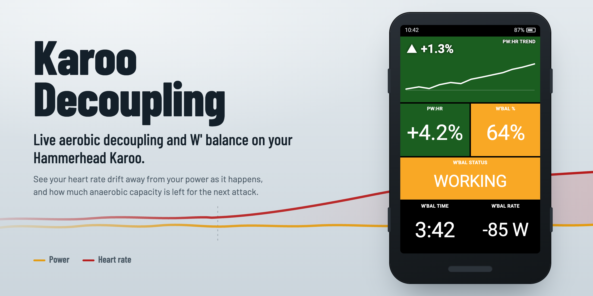

<p align="center">
  
</p>

<p align="center">
  <a href="https://github.com/schaefer-dev/karoo-decoupling/releases/latest"></a>
  <a href="https://github.com/schaefer-dev/karoo-decoupling/releases"></a>
  
  <a href="LICENSE"></a>
</p>

# Karoo Decoupling

A Hammerhead Karoo extension that shows two training signals live, while you ride:

- **Aerobic decoupling (Pa:Hr).** How far your heart rate has drifted away from your
  power since the start of the ride. It's the number TrainingPeaks and Intervals.icu
  show you *after* the ride, now on your bar mount.
- **W′ balance.** How much anaerobic capacity you have left, using the Skiba model
  with your own Critical Power and W′.

Seven data fields, updated every second, color-coded like Karoo's built-in zone fields.

---

## Data fields

| Field            | Shows                                                                                       | Example    |
|------------------|---------------------------------------------------------------------------------------------|------------|
| **pw:hr**        | Pa:Hr drift between the first and second half of your moving time                           | `+4.2%`    |
| **pw:hr trend**  | 60-min sparkline of the drift, plus how much it changed over the last 20 min                | `▲ +1.3%`  |
| **W'bal %**      | Anaerobic capacity remaining, as a percentage of W′                                         | `64%`      |
| **W'bal kJ**     | Anaerobic capacity remaining, in kilojoules                                                 | `13.7 kJ`  |
| **W'bal status** | Status band: FRESH / GOOD / WORKING / DEPLETING / CRITICAL / EMPTY                          | `WORKING`  |
| **W'bal time**   | Time until W′ is empty (above CP) or fully recovered (below CP)                             | `3:42`     |
| **W'bal rate**   | Net W′ change in watts: `-` depleting, `+` recovering                                       | `-85 W`    |

Mix and match them on any data page. For example, put **pw:hr** on your endurance-ride page
and **W'bal %** with **W'bal time** on your interval page.

---

## Install

Requires a **Karoo 2 or Karoo 3** with a paired **power meter** and **heart rate monitor**.
Decoupling needs both sensors; W′ balance only needs power.

### Option A: Hammerhead Companion app (Karoo 3, no cable)

1. On your phone, open the [latest release](https://github.com/schaefer-dev/karoo-decoupling/releases/latest).
2. Long-press **`karoo-decoupling.apk`** and share the link to the **Hammerhead Companion** app.
3. Confirm the install prompt on your Karoo.

This needs a recent Karoo software build and Companion app version, with the Karoo on Wi-Fi.
See Hammerhead's [Companion App Sideloading](https://support.hammerhead.io/hc/en-us/articles/31576497036827-Companion-App-Sideloading)
article. Apps installed from a GitHub link can be updated later from the app's details page
on the Karoo.

### Option B: USB + adb (Karoo 2 and 3)

1. Download `karoo-decoupling.apk` from the [latest release](https://github.com/schaefer-dev/karoo-decoupling/releases/latest).
2. [Enable USB debugging](#enable-usb-debugging) on the Karoo and connect it.
3. Install:

   ```sh
   adb install -r karoo-decoupling.apk
   ```

---

## Setup

1. **Enable the extension.** Go to **Settings → Extensions** and switch **Decoupling** on.
2. **Enter your CP and W′.** Tap the extension in that list (or open *Decoupling* from the
   app drawer) and fill in:

   | Setting            | Default  | Range         |
   |--------------------|----------|---------------|
   | Critical Power     | 264 W    | 50 – 600 W    |
   | W′ (anaerobic work)| 21,400 J | 5,000 – 40,000 J |

   W′ balance is only as good as these two numbers. Take them from a recent CP test, or
   from the power-duration model in Intervals.icu, WKO or Golden Cheetah. You can change
   them mid-ride; the next tick picks them up.
3. **Add the fields.** Go to **Settings → Ride Profiles → (profile) → Data Pages → Edit**,
   tap a slot, and pick a field from the **Decoupling** group.

---

## How it works

### Aerobic decoupling (pw:hr)

The Efficiency Factor is `EF = average power / average heart rate`. The extension compares
EF in the **first half** of your moving time with EF in the **second half**:

```
drift % = (EF₁ − EF₂) / EF₁ × 100
```

- **Moving time only.** Samples come once per second of Karoo's `ELAPSED_TIME`, which pauses
  when you stop, so coffee stops don't count.
- **Live preview.** The split point moves with the ride. What you see is the drift your
  ride would have if you stopped right now.
- **Warm-up.** The field shows `—` for the first 120 s of moving time, then switches to a value.
- **New ride, fresh start.** Stopping and starting a new ride resets the field.
- **Sensor dropouts.** If power or HR drops out briefly, the last known value is used
  instead of blanking the field.

**Example.** Hour 1 averages 200 W at 145 bpm, so EF₁ = 1.379. Hour 2 averages 200 W at
158 bpm, so EF₂ = 1.266. Drift = (1.379 − 1.266) / 1.379 = **+8.2%**: same power, but
your heart had to work noticeably harder in the second hour.

Positive drift means HR rose relative to power (classic cardiac drift). Negative drift means
power rose relative to HR. Under about 5% on a long steady ride is usually read as good
aerobic durability.

### pw:hr trend

Keeps a 60-minute history of the pw:hr value and draws it as a sparkline. The number in the
corner is how much the drift moved over the last 20 minutes (`▲` rising, `▼` falling, `▬` flat
within ±0.3 points). It tells you whether you're still sliding or have stabilized.

### W′ balance (Skiba differential model)

W′ is the finite amount of work you can do above Critical Power. Every second:

```
P > CP:   dW′/dt = (W′max − W′) / τ − (P − CP)    // spending, while still recovering a little
P ≤ CP:   dW′/dt = (W′max − W′) / τ               // recovering toward full
```

with τ = 546 s. W′ is clamped to `[0, W′max]` and starts full at the beginning of each ride.
**W'bal time** divides the remaining (or missing) W′ by the current rate. **W'bal rate**
is that rate, `dW′/dt`, in watts.

---

## Colors

**pw:hr** and **pw:hr trend** (background follows the current drift):

| Drift      | Color  | Reading                              |
|------------|--------|--------------------------------------|
| < 0%       | Blue   | Power rose relative to HR            |
| 0 – 5%     | Green  | Coupled: good aerobic durability     |
| 5 – 8%     | Yellow | Noticeable drift                     |
| 8 – 11%    | Orange | Significant drift                    |
| > 11%      | Red    | Strong decoupling                    |
| warming up | Grey   | Less than 120 s of moving time       |

**W'bal %**, **W'bal kJ** and **W'bal status**:

| W′ remaining | Status    | Color       |
|--------------|-----------|-------------|
| > 90%        | FRESH     | Green       |
| 70 – 90%     | GOOD      | Light green |
| 50 – 70%     | WORKING   | Amber       |
| 30 – 50%     | DEPLETING | Orange      |
| 10 – 30%     | CRITICAL  | Red         |
| < 10%        | EMPTY     | Grey        |

**W'bal time** and **W'bal rate** use a plain black background, like Karoo's standard numeric fields.

### Update cadence

All math runs on every one-second sample. The W′ fields also redraw every second.
**pw:hr** and **pw:hr trend** redraw about every 30 s to save battery, because drift changes
slowly. The first pw:hr value appears right after the 120 s warm-up, without waiting for the
next 30 s redraw.

---

## Troubleshooting

| Symptom                                                    | Fix                                                                                                   |
|------------------------------------------------------------|-------------------------------------------------------------------------------------------------------|
| Decoupling fields aren't in the field picker               | Enable the extension under **Settings → Extensions → Decoupling**.                                     |
| **pw:hr** stays on `—`                                     | You need 120 s of moving time, and both HR and power must be paired and streaming.                    |
| W′ balance drops too fast or too slow                      | Check CP and W′ in the extension settings. A CP that's too low makes every effort look anaerobic.     |
| A trailing `*` appears after values                        | You installed a debug build that shows simulated data. Install the release APK.                       |
| `adb install` fails with `INSTALL_FAILED_UPDATE_INCOMPATIBLE` | A build signed with a different key is installed. Run `adb uninstall com.karoo_decoupling`, then reinstall. |

---

## Building from source

### Requirements

- **JDK 17**, the Android SDK command-line tools, and `adb` on your `PATH`
  (Android Studio is optional).
- A **GitHub personal access token** with the `read:packages` scope. The Karoo SDK
  ([`hammerheadnav/karoo-ext`](https://github.com/hammerheadnav/karoo-ext)) is published to
  GitHub Packages, not Maven Central.

Add the token to `~/.gradle/gradle.properties`:

```properties
gpr.user=your-github-username
gpr.key=ghp_xxxxxxxxxxxxxxxxxxxx
```

You can also export `USERNAME` and `TOKEN` environment variables.

### Build and install

```sh
export JAVA_HOME=$(/usr/libexec/java_home -v 17)   # macOS

./gradlew :app:assembleRelease
# -> app/build/outputs/apk/release/karoo_decoupling-1.0.3-release.apk

adb install -r app/build/outputs/apk/release/karoo_decoupling-1.0.3-release.apk
```

Release builds are signed with the local Android debug keystore, so they install directly.

### Enable USB debugging

1. On the Karoo, open **Settings → About** and tap **Build number** seven times.
2. Open **Settings → System → Developer Options** and turn on **USB debugging**.
3. Connect over USB and accept the prompt on the device. `adb devices` should list it as
   `device` (not `unauthorized`).

### Debug builds and the simulator

`./gradlew :app:assembleDebug` builds a version that ignores your sensors and plays back a
deterministic synthetic ride, so you can check rendering on a real Karoo without riding.
It's controlled by `BuildConfig.DEBUG`, so release builds can never use simulated data.

| Aspect          | Debug                                                             | Release                                         |
|-----------------|-------------------------------------------------------------------|-------------------------------------------------|
| Data source     | `SimulatedStreams.kt`: no sensors needed                          | Live HR and power from the Karoo                 |
| Simulated pace  | 10× real time: an 8-minute test ride takes about 48 s             | Real moving time                                |
| pw:hr redraw    | Every tick                                                        | About every 30 s                                |
| Marker          | Trailing `*` (e.g. `+11.3% *`)                                    | None                                            |

The simulator holds 200 W throughout and ramps HR from 140 to 170 bpm between minutes 4 and 8,
which settles at roughly **+10 to +12%** drift. For W′ it alternates 60 s at 350 W with
60 s at 120 W, producing a deplete-and-recover sawtooth.

### Tests

The math and stream logic live in plain Kotlin classes with no Android dependencies, so they
run as fast JVM unit tests:

```sh
./gradlew :app:testDebugUnitTest
./gradlew :app:testDebugUnitTest --tests "*Calculator*"    # pure math
./gradlew :app:testDebugUnitTest --tests "*Coordinator*"   # stream coordination
```

- **Calculators** (`DecouplingCalculatorTest`, `WBalCalculatorTest`): the drift formula,
  warm-up gate, Skiba integration, status bands, and the guards against bad input.
- **Coordinators** (`DecouplingCoordinatorTest`, `WBalCoordinatorTest`): sensor, ride-state and
  elapsed-time streams driven with real flows under `runTest`, with no mocks. This covers
  pauses, ride resets and settings changes.

---

## License

[MIT](LICENSE) © 2026 Daniel Schäfer
